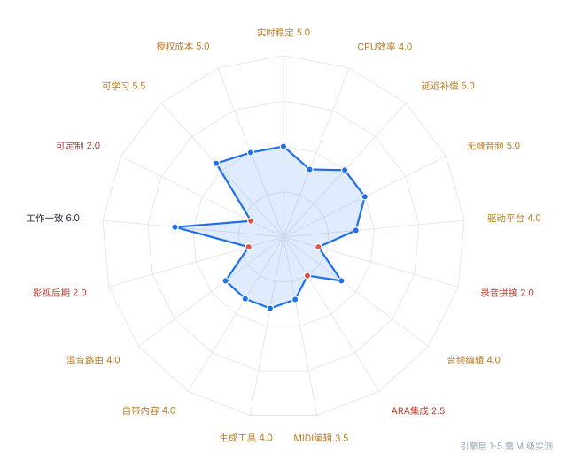

# 《AtomicDAW》DAW 评测

> **AtomicDAW P92 是『音符级编组 + 图层叠加』这一套想法的原型机：节奏与 MC 编辑的心智模型已经成立，但作为能交付作品的 DAW，录音链路（无 take / 无监听 / 无录音侧补偿）、混音总线（0 条 send / 无侧链）与 MIDI 力度、CC 三处结构性缺口，让它对『录音棚』与『影视后期』两个场景不成立，对『卧室制作』也只能承担编曲半边。**

| 项 | 值 |
|---|---|
| 版本 / 平台 | Phase 92（commit f3e8c66） / Windows 11 26300 |
| 授权模式 | 自研未发布（无定价、无授权模型） |
| 主判场景 | 通用 |
| 硬件基线 | Intel Core i7-13700KF（8P + 8E，16 核 24 线程） · 32 GB · 未接专业声卡（无 RTL 数据） |
| 采样率 / 缓冲 | 44100 Hz / 未测（--snapshot 不打开声卡） |
| 测试时长 | 3 小时 |
| 体验官 / 日期 | 陈俊龙 / 2026-10-30 |

## 总分

**1.6 / 10　等级 F（不成立）**

| 计算步骤 | 数值 |
|---|---|
| 加权基线 | 4.06 |
| 短板惩罚 | −2.38（加权缺口 1.94 × 0.5 + 严重项 0.71 + 引擎项 0.70） |
| 惩罚后 | 1.68 |
| 封顶 | 4.9 |
| **最终** | **1.6** |

封顶原因：4 项 ≤3 分 → 封顶 4.9

## 引擎体检表

| 实验 | 名称 | 实测值 |
|---|---|---|
| E1 | 阶梯负载 | 容量上限(轨) 32 · 首次爆音负载 未测（无实时设备，无法计数 dropout） |
| E2 | 60 分钟长跑 | 崩溃次数 0 |
| E3 | 延迟补偿抵消 | 硬件插入 ping 无硬件插入功能 |
| E4 | 无缝音频 | 测试操作数 0 · 失败项 0 |
| E5 | 驱动平台 | 插件格式 VST3 仅此一种；无 VST2 / AU / AAX / CLAP；内置 8 种效果 |

## 场景适配矩阵

| 场景 | 得分 | 等级 | 定位 |
|---|---|---|---|
| 录音棚/专业混音 | 1.4 | F | 出局 |
| 电子/Beatmaking | 2.0 | F | 出局 |
| 影视/游戏后期 | 1.0 | F | 出局 |
| 现场演出 | 2.4 | F | 出局 |
| 初学者/预算有限 | 2.1 | F | 出局 |

最优：现场演出（2.4）；最差：影视/游戏后期（1.0）；分差 1.4 —— 均衡型

## 评分卡

| # | 指标 | 分 | 证据 | 权重 | 结论 |
|---|---|---|---|---|---|
| 1 | 实时稳定性 | 5.0 | S | 11 | 没有任何 dropout 计数器，也没有实时设备可用：60 分钟长跑与爆音计数一条都没测到，5.0 是『未知』而不是『及格』。代码侧唯一的稳定性证据是音频线程不读模型（只读不可变 schedule）。 |
| 2 | CPU 效率与多核调度 | 4.0 | M | 8 | 单线程渲染：32 轨（每轨 240 音符 + EQ + COMP）离线 25.2× 实时，8 轨 45.8×，1 轨 318×。绝对吞吐够用，但加核零收益——没有 worker pool，实时线程一颗核顶到满就是全部上限。 |
| 3 | 延迟与延迟补偿 | 5.0 | S | 8 | PDC 有唯一解算表且只在汇合点补偿（P83 的正确形状），但反相抵消一次都没测到残余 dB；另外录音路径完全不补偿，监听在代码里根本不存在——录音棚场景这一项是结构缺口，不是精度问题。 |
| 4 | 无缝音频与热插拔 | 5.0 | S | 3 | 无 loopback 采集，7 项热插拔操作一项未测；架构上整块换 schedule 指针（getScheduleRaw 是 acquire load）意味着插入插件不该停播，但『没有停播路径』和『没有 gap』是两回事，必须回采才算数。 |
| 5 | 驱动与平台层 | 4.0 | S | 5 | 插件格式只有 VST3（CMakeLists 里 VST/AU 全关），AAX 缺失即录音棚出局；设备设置窗能改驱动与缓冲，但启动时不点名 ASIO，RTL 与 DPC 全未测。 |
| 6 | 录音与 comping | 2.0 | S | 7 | W1 无法完成：录第二遍只是往同一图层再叠一个『录音 N』组，没有 take 容器、没有 take lane、没有接缝交叉淡化，也没有输入监听（输出块先被清空，输入从不混入）。多遍录音在结构上不成立。 |
| 7 | 音频编辑与时间处理 | 4.0 | S | 7 | W2 能做完但只有整块处理：两种读头半 grain 交叉淡化，grain 固定 50 ms 不可调，比例夹在 0.125–8.0，没有 transient 检测、没有 warp marker、没有质量档，逐拍变调只能靠整块变调近似。 |
| 8 | ARA 深度集成 | 2.5 | S | 3 | 全源码零 ARA 符号（ARAAudioSource / DocumentController 均无）；W3 只能把 Melodyne 当普通 VST3 插在通道上，跨 clip 编辑、随工程保存这些 ARA 语义全部没有。 |
| 9 | MIDI 编辑深度 | 3.5 | S | 7 | W4 只能做一半：力度只显示『vel 0.80』没有任何拖拽/输入手势，CC lane 完全不存在（录制的 CC 只被折算成组的 level/pan）；有的是量化（5 档网格 × 4 档强度）与音符级 level/pan/pitch 包络。 |
| 10 | 编曲与生成式工具 | 4.0 | S | 4 | W5 的『生成一个 variation』不可完成：零琶音器、零概率/随机化、零 pattern 变体管理；能用的只有量化、组复制（含自动化）与『渲染为采样』这种手工打印。 |
| 11 | 自带乐器与内容 | 4.0 | S | 8 | 能出声但撑不起作品：合成器每 voice 单振荡器 4 波形 + 一阶低通，无 ADSR/包络/ unison；采样器只是容器没有 keyzone 与力度层；8 种效果（LP/DRIVE/DELAY/AIR/EQ/COMP/REVERB/VST3）覆盖了混音骨架但每个都只有 2-6 个参数。 |
| 12 | 混音与路由深度 | 4.0 | S | 7 | W6 无法完成：0 条 send/aux/return、无侧链（COMP 没有外部键输入）、无 VCA、无并行返回；只有『通道输出接另一通道或主输出』的单向串联（带拓扑排序与环检测）+ master，127 条同级通道、每通道 8 插槽。 |
| 13 | 影视/沉浸声工具链 | 2.0 | S | 4 | W8 三项都不可完成：无视频轨、无时间码/SMPTE、无 AAF/OMF，工程是纯立体声（连 5.1 采样都只保留两声道）。 |
| 14 | 一致性与认知负荷 | 6.0 | S | 5 | 模型层一致性是这台的强项：同一个动作在各视图里走同一条规则（按下的话事权归『你以为在按的东西』、双击=打开、改名只在名字那一行）。但界面没有 tooltip、没有 dropout/CPU 显示，『现在是不是在改组』这类状态仍要靠边框猜。 |
| 15 | 可定制性 | 2.0 | S | 4 | W9 两项都不可完成：快捷键全部硬编码在 keyPressed 与 handleGlobalKeyPress，菜单里的按键只是文案；没有 keymap 文件、没有宏、没有脚本、主题是编译期常量、布局（缩放/滚动/窗口位置）不入工程文件。 |
| 16 | 可学习性 | 5.5 | S | 6 | 中文标签 + 新会话自带一层一音源，画个音符按空格就出声（约 4 步），但概念密度高（图层/编组/出现/机架/插入/自动化五套名词），无内置帮助、无 tooltip，第 9 条『错误可恢复』靠恢复副本（P84）兜底。 |
| 17 | 授权成本与性价比 | 5.0 | S | 3 | 未发布、无定价、无授权模型，按中性 5.0 占位；不参与任何选型结论。 |

## 致命伤诊断

### 1. 录第二遍就多出一个『录音 N』组，永远拼不成一条最佳版本；录音时也听不到自己。

- **证据**：W1 不可完成：MainComponent.cpp:4529 每遍只 addGroup（录音 N），无 take 容器；AudioEngine.cpp:321 输出块清空后输入从不混入，全源码无 inputMonitor。
- **根因**：录音被实现成『往图层追加一个组』，而不是『一条轨上的一组 take』；信号链里没有监听分支（引擎只有播放路径）。
- **影响面**：录音棚、人声/乐器录制、任何需要多遍挑片段的场景直接出局；这也是『录音侧延迟补偿』缺失的同一处缺口。

### 2. 任何带画面的活都做不了：不能导入视频、对不到帧、导不出带画面的混音。

- **证据**：W8 三项均不可完成：Source 内无 video/SMPTE/AAF 符号；SampleLibrary.cpp:184 明确 5.1 只保留两声道。
- **根因**：工程模型是纯音乐时间轴（拍为唯一单位），没有帧/时间码这一层时间表示，也没有多声道总线。
- **影响面**：影视后期、游戏音频、广告配乐全部不可用；也是导出只能 44.1k 立体声的同源问题。

### 3. 用熟了也快不起来：改不了键位、存不了布局、没有宏，换台机器一切归零。

- **证据**：W9 两项均不可完成：快捷键写死在 MainComponent.cpp:6536/6622；ProjectIO 不保存 zoom/scroll/窗口位置；主题是 Theme.h 的编译期常量。
- **根因**：命令没有 id 层——菜单项直接调用成员函数，按键直接 switch 硬编码，所以没有可被重绑定的『命令』对象。
- **影响面**：长期用户的肌肉记忆无法沉淀，重度编曲效率停在鼠标层；这也是所有工作流类分数的隐形天花板。

### 4. 修音只能开一个插件窗，改完不能随手回到时间线上继续。

- **证据**：W3 只能当普通 VST3 插入：全源码零 ARA 符号；跨 clip 编辑、随工程保存均无。
- **根因**：宿主侧没有实现 ARA2 的文档/音源映射层，插件只能看到实时音频块。
- **影响面**：人声修音、和声对齐、鼓替换这类高频工序效率减半；对录音棚场景是持续摩擦。

## 建议（按 影响×确定性÷成本 排序）

| 优先级 | 建议 | 适用场景 | 影响 | 确定性 | 成本 | 验收标准 |
|---|---|---|---|---|---|---|
| 7.5 | 先让引擎『可观测』：dropout 计数 + 单核占用显示 | 全场景（尤其现场） | 3 | 5 | 2 | 播放时界面实时显示 dropout 计数与块耗时峰值；人为在音频线程里 sleep(2× 块长) 能稳定计到 dropout（自检可断言该计数 +1）。 |
| 5.3 | 补力度与 CC lane（先把『能改』做出来，再谈精细） | 电子 / 卧室制作 | 4 | 4 | 3 | W4 的 16 个音符力度可一次框选改完（操作步数 ≤3，t ≤20 s）；画出的 CC1 能驱动宿主 VST3 并在导出波形中可测（同一工程两次导出 RMS 差 <0.1 dB）。 |
| 5.0 | 给录音链路补上『监听 + 录音侧延迟补偿』 | 录音棚 / 卧室制作 | 5 | 4 | 4 | E3-D 可复现：监听链插 50 ms 线性相位插件，录 1 kHz 点击串，录回波形瞬态相对参考点偏移 ≤1 ms（44 采样内）；关掉插件后偏移 ≤0.1 ms。 |
| 4.0 | 把『录音 N』升级成 take 容器，再做 comping | 录音棚 | 5 | 4 | 5 | W1 四遍 8 小节、3 处跨遍拼接，熟练用户中位耗时 ≤150 s；接缝回采在 ±2 ms 内振幅连续（无 click 尖峰 > -40 dBFS）。 |
| 4.0 | 混音台加 send/return 与侧链输入 | 录音棚 / 电子 | 4 | 4 | 4 | W6 三项（3 轨编组、kick 侧链 bass、并行压缩返回）全程 ≤200 s；反相测试：同一信号经『通道直连主输出』与『经一条 send 到 return 再回主输出』，残余 ≤ -60 dBFS。 |
| 4.0 | 命令 id 层 + keymap 持久化 | 全场景 | 3 | 4 | 3 | 同一个动作（如『量化 1/16』）可从菜单、快捷键、自定义键位三条路触发且行为一致；改键后重启仍生效（写盘可读回）。 |

### 具体动作

- **先让引擎『可观测』：dropout 计数 + 单核占用显示**：AudioEngine 在 audioDeviceIOCallback 里统计『块超时/丢弃』次数与每块耗时峰值，主界面显示 dropout 计数与最差单核占比。这是所有引擎类评测的前置条件——没有它，谁都没法判断一次爆音是引擎还是系统。
- **补力度与 CC lane（先把『能改』做出来，再谈精细）**：钢琴窗底部加一条可切换 lane：velocity 柱状（框选批量 + 拖拽）与 CC 曲线（至少 CC1/11/64）；velocity 改动走既有 notesChanged + 撤销手势，不要新开一条数据通路。
- **给录音链路补上『监听 + 录音侧延迟补偿』**：在 AudioEngine 的输出块里加一条监听分支（输入直通 + 该轨插件链），并把录音写盘按该轨 PDC 延迟前移。先做直通监听，再挂插件链。
- **把『录音 N』升级成 take 容器，再做 comping**：给录音组加 take 归属（同一 takeSet 的第 n 遍），钢琴窗/时间线显示 take lane，接缝处自动 3-5 ms 交叉淡化；comp 结果仍落成一个组，保持『组=可复制的一次出现』的现有语义。
- **混音台加 send/return 与侧链输入**：通道加 2 条 send（推子前/后可选）+ 独立 return 通道；COMP 加外部键输入，侧链源从『任一通道/总线』选。侧链延迟并入既有 pdc::solve 的唯一延迟表，不要新开补偿路径。
- **命令 id 层 + keymap 持久化**：把菜单/快捷键收敛成『命令表（id → 名称 → 默认键）』，keyPressed 查表派发；keymap 与窗口布局存进 ApplicationProperties/工程文件。

## 局限性

- 覆盖范围：引擎：仅 cpu_efficiency 取得离线渲染实测（1/8/32 轨阶梯）；rt_stability / latency_pdc / seamless_audio / driver_platform 因无实时设备、无 loopback 采集链路未测，按 5.0 中性占位。工作流：W1-W9 只做了源码级可达性判定（c 步数 / x 视图切换可数，t 无法计时），未做真人计时。视觉：--snapshot 31 张 + 自检 865 条。
- 未覆盖：rt_stability / latency_pdc / seamless_audio / driver_platform 四项没有实时测量。原因具体：--snapshot 模式按设计不打开声卡（Main.cpp:677），沙箱无法启动 GUI 或驱动，机器上没有可用于 loopback 的采集链路。这四项按协议给 5.0 中性占位，不是及格分。
- 硬件偏差：单机单次，i7-13700KF + 32 GB + 无专业声卡；离线渲染数据与实时表现不是一回事（实时受驱动、DPC、调度影响，离线只看 DSP 成本）。跨机复测（Step 7 校准）未做。
- 单人体验官偏差：评审者熟悉源码，learnability 与 workflow 的步数是读代码数出来的 c / x，没有真人计时 t；对老用户友好的地方可能被高估。
- 样本偏差：只测 44.1 kHz、只有内置效果与一个工程规模；没有第三方 VST3 参与，插件崩溃隔离（子进程扫描 + SEH）只在代码层读过，没有实测。
- cost_model 无公开定价（未发布），按中性 5.0 占位，不参与结论；评分卡里的总分应当读作『相对商业 DAW（7-9 分区间）的成熟度指数』，不是对一个 0.x 项目的成绩单。
